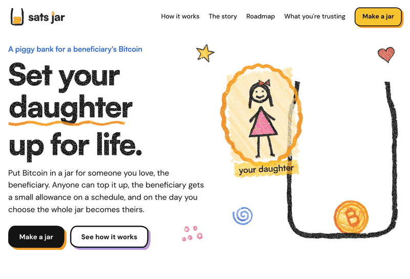
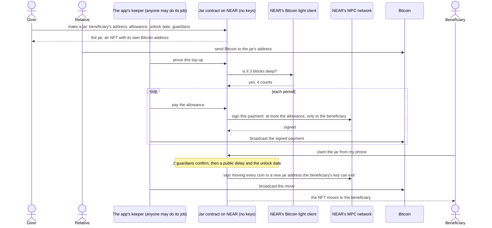
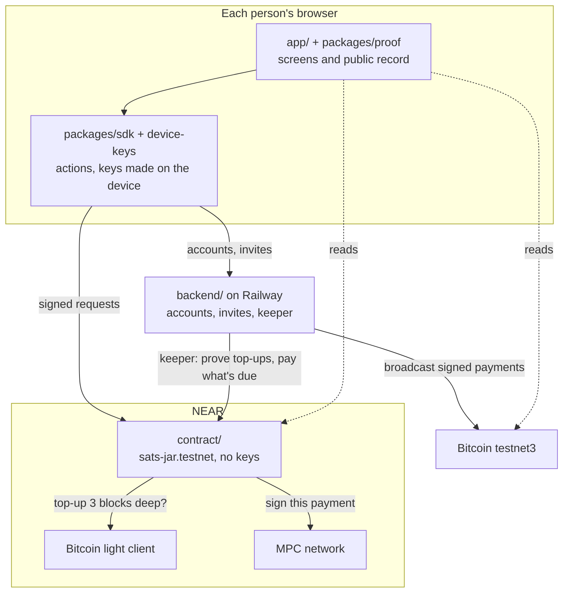

<p align="center">
  <picture>
    <source media="(prefers-color-scheme: dark)" srcset="docs/readme/sats-jar-logo-dark.svg">
    
  </picture>
</p>

<h3 align="center">Set your loved one up for life.</h3>

<p align="center">
A jar is an NFT on NEAR that holds real Bitcoin for someone you love, the beneficiary. Anyone tops it up from a Bitcoin wallet. A NEAR contract with no keys builds each payment itself and asks NEAR's MPC network to sign it only when the jar's rule allows: a capped allowance each period and, from the unlock date, the whole jar to the beneficiary.
</p>

<p align="center">
  <a href="https://testnet.nearblocks.io/txns/5oZWjXhYuGGVmq4HRcVrnrLTVpGCwDfZMS2XojSWWvCV"></a>
  <a href="https://mempool.space/testnet/tx/c9d3f1faaf1fa6c372339808f6263105e9642bbad59975d751f1094854490b5e"></a>
  <a href="https://testnet.nearblocks.io/txns/A7n7bLAHwctfwy3HrZo9tNiVS2U48ZY9RR2nxg8ViaLo"></a>
</p>

<p align="center">
  <!-- PENDING: demo video URL --><a href="#">Demo video</a> ·
  <a href="https://satsjar.app">Live site</a> ·
  <a href="#try-it-in-30-minutes">Try it in 30 minutes</a> ·
  <a href="#testnet-proof">Testnet proof</a> ·
  <a href="#check-every-claim-yourself">Check every claim yourself</a> ·
  <a href="#hackathon-tracks">Tracks: nfts, open</a>
</p>

<p align="center">
  
</p>

## Who it's for

- A parent or grandparent, the giver, who wants to give someone real Bitcoin that ends up theirs alone.
- Relatives and friends, who top up the jar from any Bitcoin wallet or exchange app.
- Two or three trusted adults, the guardians, who approve emergency payments and confirm the handover.
- The beneficiary, who gets a small allowance each period and, from the unlock date, the whole jar on their own phone.

## The problem

Someone too young to hold Bitcoin needs an adult or a company to hold it for them, and whoever holds it can spend it, lose it or never hand it over. A family wants rules instead: a little each month, nothing else except a real emergency, and the whole jar to the beneficiary once they're grown. Bitcoin alone can't enforce rules like that.

## Why NEAR

| Promise | What on NEAR keeps it | Testnet evidence |
|---|---|---|
| Nobody can change the rule or move coins outside it, the team included | The jar contract `sats-jar.testnet` has no access keys, and its code hash matches a reproducible build of this repo | [Every key deleted](https://testnet.nearblocks.io/txns/5oZWjXhYuGGVmq4HRcVrnrLTVpGCwDfZMS2XojSWWvCV) |
| A jar pays only what its rule allows | Chain Signatures: the contract builds each Bitcoin payment and its signature hash itself, then asks NEAR's MPC network to sign. No person holds the jar's Bitcoin key | [Allowance request](https://testnet.nearblocks.io/txns/4UGpg2zPVA2gkU3a6WVwnNF16jnoxZXG3i3yDELDWzwm) → [Bitcoin payment](https://mempool.space/testnet/tx/c9d3f1faaf1fa6c372339808f6263105e9642bbad59975d751f1094854490b5e) |
| Only real, confirmed Bitcoin counts | NEAR's Bitcoin light client confirms each top-up is 3 blocks deep before the contract counts it | [Top-up proven](https://testnet.nearblocks.io/txns/DLBwY8ghA1fjqdpXWVd2MHLYMUzGTN6w6Kz2zpq5mZKx) |
| The jar is an NFT that owns its Bitcoin | A NEP-171 token whose picture the contract draws from the jar's balance. When it changes hands, its Bitcoin first moves to an address whose Bitcoin-only exit is the new holder's key, then the token moves | [Jar 1 minted](https://testnet.nearblocks.io/txns/AVAy6oMPrAn5B8JMDUtNuNSbbJCRd5TBN44XtKaY9pFc), [Bitcoin moved](https://mempool.space/testnet/tx/5f90716bd2a9a8acf5df517d7ac0b13a9a72b0cb6a085f8286db13a280332393) → [token moved](https://testnet.nearblocks.io/txns/34cWrygt1VWSJn66pJsc69uijpwwU21tgeLcNzLg6e2i) |
| Nobody sees a wallet, gas or an account name | Each person gets a sub-account of the app's account whose only key is made on their own device, and the app pays its NEAR fees | [`evidence/backend-accounts.json`](evidence/backend-accounts.json) |

## How it works



1. **Make a jar.** The giver picks the beneficiary's Bitcoin address, the allowance per period, the unlock date, and 2 or 3 guardians. Until handover the jar sits in the giver's family account.
2. **Anyone can top it up.** Anyone sends Bitcoin to the jar's address. Once it has 3 confirmations, the contract checks it through the light client and it counts.
3. **A little at a time, then all of it.** Each period the beneficiary gets at most the allowance; a missed period carries over, up to three periods' worth. Bitcoin fees come out of the jar, at most a tenth of the allowance per period. The beneficiary claims the jar, two guardians confirm, and once a public delay has passed and the jar has unlocked, the jar and its Bitcoin pass to the beneficiary. Every adult's access ends there.

In an emergency, two guardians can send the beneficiary up to three periods' allowance at once, after a public delay during which the giver can cancel it.

## Testnet proof

Everything below happened to jar 1 on the locked contract on 13 Nov 2026, made through the hosted app with demo timing (a period is 10 minutes, not a month). The contract is [`sats-jar.testnet`](https://testnet.nearblocks.io/address/sats-jar.testnet), built from commit [`ecf8379`](https://github.com/koukikouks/sats-jar/tree/ecf837925736db4f684f53846d12a59a57b0df01). It signs through `v1.signer-prod.testnet` (NEAR's MPC network) and checks Bitcoin through `btc-client-v4.testnet` (NEAR's Bitcoin light client).

Jar 1's rule: up to 2,500 sats every 10 minutes, an emergency payment of up to 7,500 sats, 2 guardians, unlock on 13 Nov 2026 at 21:31 UTC. The beneficiary's address, [`tb1q66wd…lc3yj`](https://mempool.space/testnet/address/tb1q66wdw474ycjhqt078gkup2ltvy3dxz87ulc3yj), is a test wallet that also sent the top-up. Each test link opens the contract test that proves the same step.

| Role | NEAR account |
|---|---|
| Giver: the family account, and guardian 1 | [`6d51e1ac2c675964a125.sats-jar-app.testnet`](https://testnet.nearblocks.io/address/6d51e1ac2c675964a125.sats-jar-app.testnet) |
| Guardian 2 | [`0ddc7ba3e015e60238a7.sats-jar-app.testnet`](https://testnet.nearblocks.io/address/0ddc7ba3e015e60238a7.sats-jar-app.testnet) |
| Beneficiary | [`1ac525d727cfd5a4b6e0.sats-jar-app.testnet`](https://testnet.nearblocks.io/address/1ac525d727cfd5a4b6e0.sats-jar-app.testnet) |
| Outsider | [`2fe04a619d71531c7248.sats-jar-app.testnet`](https://testnet.nearblocks.io/address/2fe04a619d71531c7248.sats-jar-app.testnet) |
| New holder, after the beneficiary transfers the jar | [`69093ade7e19df8671b7.sats-jar-app.testnet`](https://testnet.nearblocks.io/address/69093ade7e19df8671b7.sats-jar-app.testnet) |
| The app's keeper, which proves top-ups and sends due payments | [`keeper-locked.sats-jar-app.testnet`](https://testnet.nearblocks.io/address/keeper-locked.sats-jar-app.testnet) |

| # | What happened | NEAR | Bitcoin | Proved by test |
|---|---|---|---|---|
| 1 | The giver makes the jar. The NFT goes to the family account | [create_jar](https://testnet.nearblocks.io/txns/AVAy6oMPrAn5B8JMDUtNuNSbbJCRd5TBN44XtKaY9pFc) |  | [A new jar is a standard nft held by the family account](https://github.com/koukikouks/sats-jar/blob/ecf837925736db4f684f53846d12a59a57b0df01/contract/tests/nft.rs#L90) |
| 2 | Guardian 2 proposes a 9,000-sat emergency payment: refused, `OVER_EMERGENCY_CAP` | [refused](https://testnet.nearblocks.io/txns/6YtzBnk6kLy92DLay6e32JmMS2i5rKhx2Fsj9c2QaQw5) |  | [An emergency payment is capped at three periods' allowance](https://github.com/koukikouks/sats-jar/blob/ecf837925736db4f684f53846d12a59a57b0df01/contract/tests/emergency.rs#L75) |
| 3 | Guardian 2 proposes 3,000 sats and the giver approves as guardian 1, then cancels it during its public delay | [propose](https://testnet.nearblocks.io/txns/CqiD2ux4Emih2NF23DdyVtE8ZgZXmhLxf5psjJeKNfiv), [approve](https://testnet.nearblocks.io/txns/8E1mYYFhhduSiUo7ma7THspJSDzzHSw5nTKR8r5DE4td), [cancel](https://testnet.nearblocks.io/txns/FYSXzMCKLgZAM3LvypL9vP9HiAwCtFUhsq9nuNdLuyMx) |  | [The giver cancels a proposal before and during its delay](https://github.com/koukikouks/sats-jar/blob/ecf837925736db4f684f53846d12a59a57b0df01/contract/tests/emergency.rs#L176) |
| 4 | The giver proposes 3,000 sats again and guardian 2 approves, which starts a 30-minute public delay | [propose](https://testnet.nearblocks.io/txns/726dU4zrA2KbJGGojcbyBeaurYHQDx8Li1twmo46drjA), [approve](https://testnet.nearblocks.io/txns/DuLBXP8SZPDuLyYTabxnaAgRNW4rij6h59EbTL2WLHKg) |  | [A second guardian's approval starts the public delay](https://github.com/koukikouks/sats-jar/blob/ecf837925736db4f684f53846d12a59a57b0df01/contract/tests/emergency.rs#L129) |
| 5 | An outsider asks the jar to pay 1,000 sats to another address: refused, `SPEND_BEFORE_HANDOVER` | [refused](https://testnet.nearblocks.io/txns/A7n7bLAHwctfwy3HrZo9tNiVS2U48ZY9RR2nxg8ViaLo) |  | [A spend before handover is refused for everyone until the jar has moved](https://github.com/koukikouks/sats-jar/blob/ecf837925736db4f684f53846d12a59a57b0df01/contract/tests/request_spend.rs#L15) |
| 6 | The outsider sends an emergency approval: refused, `NOT_A_GUARDIAN` | [refused](https://testnet.nearblocks.io/txns/5CpKeB8UB7SBbw71C13RuE33PCTyUcUf8ktH7mE77Bfs) |  | [A second guardian's approval starts the public delay](https://github.com/koukikouks/sats-jar/blob/ecf837925736db4f684f53846d12a59a57b0df01/contract/tests/emergency.rs#L129) |
| 7 | The beneficiary claims the jar from their phone. No guardian confirms in time, so the claim lapses | [claim](https://testnet.nearblocks.io/txns/7B5QyVRj6o6KfMDPt7UcbJjZ6TYAWqeBLnB9cTmhCSe6) |  | [The child's account claims the jar with its bitcoin key](https://github.com/koukikouks/sats-jar/blob/ecf837925736db4f684f53846d12a59a57b0df01/contract/tests/handover.rs#L12) |
| 8 | A 12,000-sat top-up lands. The keeper proves it through the light client and it counts | [prove_topup](https://testnet.nearblocks.io/txns/DLBwY8ghA1fjqdpXWVd2MHLYMUzGTN6w6Kz2zpq5mZKx) | [top-up](https://mempool.space/testnet/tx/f8612183f39e0b4c9ecb7069aa4edeb4fbdb61fb2bbce8eb809b83201f1c8449) | [A confirmed top up proven by anyone is counted as a coin](https://github.com/koukikouks/sats-jar/blob/ecf837925736db4f684f53846d12a59a57b0df01/contract/tests/prove_topup.rs#L24) |
| 9 | After the delay, the emergency payment sends the beneficiary 3,000 sats | [execute](https://testnet.nearblocks.io/txns/DJ9pQc1X5G6MLNut2P4z1pJpbePswTXLBH1pBNFsfrCZ), [confirm](https://testnet.nearblocks.io/txns/HBb5CQqXx5rCwcWkkViGEKCxxeStobehF2CLkZzZLiT9) | [payment](https://mempool.space/testnet/tx/0ac6f2b82e5b987980b77d4eaf82c2c11aa09029ba1652c373e4a2609f3e2cf1) | [Anyone executes an approved emergency after its delay paying the child exactly](https://github.com/koukikouks/sats-jar/blob/ecf837925736db4f684f53846d12a59a57b0df01/contract/tests/emergency.rs#L358) |
| 10 | One period went unpaid, so the allowance pays two periods' worth: 5,000 sats | [request](https://testnet.nearblocks.io/txns/4UGpg2zPVA2gkU3a6WVwnNF16jnoxZXG3i3yDELDWzwm), [confirm](https://testnet.nearblocks.io/txns/6DaTbf4p56RbiWsMcmdcvgjuACaY2Sd1aCqmWSj2EnmK) | [payment](https://mempool.space/testnet/tx/c9d3f1faaf1fa6c372339808f6263105e9642bbad59975d751f1094854490b5e) | [Two unpaid periods carry over into one allowance of three caps](https://github.com/koukikouks/sats-jar/blob/ecf837925736db4f684f53846d12a59a57b0df01/contract/tests/carry_over.rs#L13) |
| 11 | The beneficiary claims again and both guardians confirm, which starts the handover's public delay | [claim](https://testnet.nearblocks.io/txns/HF9X8jazxJEQ8y9aRW2okQJDYMdwyEQCruPVPWk46vPW), [confirm](https://testnet.nearblocks.io/txns/GLZDfNunG15Def2CwT7nN14vrffT6DyspEEw99BcvesV), [confirm](https://testnet.nearblocks.io/txns/HHafHhnnCVZt89VAqT3Lkc2a7PVJMNhPTb7PY5ncufAj) |  | [A claim no guardian confirms lapses and a fresh claim follows](https://github.com/koukikouks/sats-jar/blob/ecf837925736db4f684f53846d12a59a57b0df01/contract/tests/handover.rs#L300) |
| 12 | After the unlock date, the handover completes: every coin moves to a new jar address whose Bitcoin-only exit is the beneficiary's key, then the NFT moves to the beneficiary | [complete_handover](https://testnet.nearblocks.io/txns/FtpMAGFG7fyjw4SrmpabEtCWDEKR191gL7TWYGr3BXFA), [confirm](https://testnet.nearblocks.io/txns/DPZpr7HCzvaKUkpUmS4j6i77vFmLgLqVzJPKyaPEwVXY) | [move](https://mempool.space/testnet/tx/c34af883d7a3ba5c83e6631ed4013a09319d93401ca9d0d62867a9a5a82d5484) | [After the delay and unlock anyone rehomes the coins and the jar moves to the child](https://github.com/koukikouks/sats-jar/blob/ecf837925736db4f684f53846d12a59a57b0df01/contract/tests/handover_complete.rs#L15) |
| 13 | The beneficiary, now the holder, sends 1,000 sats to their own address | [request_spend](https://testnet.nearblocks.io/txns/GX8L8q3xkUuRzuWkZWdafrNH2NxUTbSCtY4cBg8j7tV9), [confirm](https://testnet.nearblocks.io/txns/4Kg9BcJ6TfLqJ52rbS4YFfySNucqsTv9cjfDUevNKQML) | [payment](https://mempool.space/testnet/tx/63f76f9702df1c0da3800eeb66edac3343ffc34ecddc8944879b611d424141d0) | [After handover the holder spends a rehomed coin to any address](https://github.com/koukikouks/sats-jar/blob/ecf837925736db4f684f53846d12a59a57b0df01/contract/tests/request_spend.rs#L69) |
| 14 | The giver tries to spend from the jar: refused, `NOT_THE_HOLDER` | [refused](https://testnet.nearblocks.io/txns/7GSv2zamtcrXnuQzUM4RyomVVmZFnBTEdu2pb4eQzZq1) |  | [After handover the family account is not the holder and nothing restarts it](https://github.com/koukikouks/sats-jar/blob/ecf837925736db4f684f53846d12a59a57b0df01/contract/tests/handover_complete.rs#L454) |
| 15 | The beneficiary tries to transfer the jar while their payment is unconfirmed: refused, `PAYMENT_PENDING` | [refused](https://testnet.nearblocks.io/txns/JBLQ7B1X76D8j9WozGZAFy64xxogR3Mv1ugkJidu8DYK) |  | [A transfer starts only after handover from the holder and waits for pending payments](https://github.com/koukikouks/sats-jar/blob/ecf837925736db4f684f53846d12a59a57b0df01/contract/tests/transfer.rs#L207) |
| 16 | The beneficiary transfers the jar and the new holder accepts with their own key. The coins move to an address whose exit is that key, then the NFT moves | [start](https://testnet.nearblocks.io/txns/7drcYDLD7DrJMqo71BQJfkLqb1p4exkxxf1DNUMU9egN), [accept](https://testnet.nearblocks.io/txns/A8ov7q7GALqzWyjM2akZPtbyLQ5SysrepGDLUZq1thta), [confirm](https://testnet.nearblocks.io/txns/34cWrygt1VWSJn66pJsc69uijpwwU21tgeLcNzLg6e2i) | [move](https://mempool.space/testnet/tx/5f90716bd2a9a8acf5df517d7ac0b13a9a72b0cb6a085f8286db13a280332393) | [The holder transfers the jar and its bitcoin rehomes to the receiver's key](https://github.com/koukikouks/sats-jar/blob/ecf837925736db4f684f53846d12a59a57b0df01/contract/tests/transfer.rs#L36) |

Every NEAR transaction that sends Bitcoin includes the contract's call to `v1.signer-prod.testnet` and logs the signed Bitcoin transaction. Each payment's Bitcoin fee came out of the jar: 163 sats per payment to the beneficiary, 132 per move. Testnet3 block times can run up to two hours ahead, so a block may show a later time than the NEAR transaction that proved it.

## Check every claim yourself

From a clone of this repo, with Node 22 or later (no keys, coins or install required):

```bash
node scripts/check-claims.mjs
```

You should see:

```
1. access keys on sats-jar.testnet: 0
2. code hash: 5xerZBZMSJ4kdJiaXkfn15aT7yBVptk4EpWnjr37i1jn
3. jar 1's Bitcoin key is the MPC network's key for it: true
4. early spend refused: SPEND_BEFORE_HANDOVER: before handover only the allowance and an emergency payment can pay out, and only to the child's address
```

1 means nobody can change the contract. 3 means no person holds the jar's Bitcoin key. To confirm the deployed code is this repo's, rebuild it with Docker and cargo-near 0.22.0; the checksum must equal line 2:

```bash
git checkout ecf837925736db4f684f53846d12a59a57b0df01
cargo near build reproducible-wasm --manifest-path contract/Cargo.toml
```

## Known gaps

- Testnet only: the coins are test coins and the contract has never run on mainnet.
- No fee replacement (RBF) yet. A payment sent at too low a fee could stay stuck and hold the jar, so mainnet needs it first ([Roadmap](#roadmap)).
- The Bitcoin-only exit is proven in the tests on regtest, not yet used on the locked contract.

## Try it in 30 minutes

Make a jar at [app.satsjar.app](https://app.satsjar.app/new) and take it through all 5 steps, playing every person yourself. It's free, needs no wallet, and most of the time is waiting for Bitcoin.

Each browser is one person, because it holds that person's keys:

| Person | Where |
|---|---|
| You: the giver and guardian 1 | your normal browser window |
| Guardian 2 | a private window, kept open until the end |
| The beneficiary | a different browser, or your phone |

Each person picks a 6-digit PIN the first time, and every reload asks for it again.

1. **Name your jar.** Open [app.satsjar.app/new](https://app.satsjar.app/new), choose a PIN and press **Save my PIN**. Type a nickname and press **Next: invite guardians**.
2. **Invite 2 guardians.** Press **Be guardian 1 myself**. Press **Copy link** next to guardian 2, open it in the private window, choose a PIN and press **Join as a guardian**. Back in your window, both guardians show "Joined" and the rules appear below.
3. **Set the rules.** Press **No test wallet? Use our demo address**. Type an allowance cap, such as 2000. Choose **Demo timing: every 10 minutes**, or the jar waits 30 days. Leave "Unlocks in (minutes)" at 30 and press **Make the jar**.
4. **Top it up.** Under "Top it up", copy the jar's address and send it at least 1,000 test sats, from the [coinfaucet.eu faucet](https://coinfaucet.eu/en/btc-testnet/) or any testnet3 wallet. "Top-ups" goes from "On the way" through "Confirming, 1 of 3" to **Counted**, usually in 10 to 30 minutes. The page updates by itself.
5. **Hand it over.** Once the top-up says Counted, press **Copy link** under "Handover" and open it in the beneficiary's browser. Press **Show my recovery phrase**, then **I've written them down**, type back the 3 words it asks for, choose a PIN, press **Finish**, then **Claim my jar**.

   Within 7 minutes, both guardians confirm: in your window, and in guardian 2's (press **Your jars**, then the jar), press **Check the beneficiary's code**, then **It matches: confirm**. The handover goes ahead once the jar unlocks, and the beneficiary's page says "Handed over".

If something looks stuck:

- **"We could not reach the network just now."** Wait a minute and press the button again.
- **The beneficiary's link says "This device is set up for an adult."** It was opened in a guardian's browser. Use a different browser or your phone.
- **The claim lapsed** because the guardians didn't confirm within 7 minutes. The beneficiary presses **Claim it again**.
- **"The jar has 0 sats"** on the claim screen: the top-up hasn't counted yet. Wait for Counted first, or the beneficiary gets an empty jar.

### Try to break the rule, without coins

1. Open jar 1's public record at [app.satsjar.app/proof/1](https://app.satsjar.app/proof/1).
2. Under "Try to break the rule", press **Spend it without holding it** or **Approve its emergency payment as an outsider**. The first time, choose a PIN, then press the button again.
3. You see "Refused:" with the contract's reason, and **Check it yourself ↗** opens the failed transaction on NearBlocks.

## Architecture



| Folder | What it does |
|---|---|
| [`contract/`](contract) | The jar contract (Rust, near-sdk): holds every jar as an NFT, runs the rule, builds each Bitcoin payment and asks the MPC network to sign it |
| [`btc/`](btc) | Bitcoin code the contract uses: segwit transactions, the jar's P2WSH script, BIP-143 signature hashes |
| [`packages/device-keys/`](packages/device-keys) | Makes each person's keys in the browser under their PIN, and the beneficiary's 12-word recovery phrase |
| [`packages/sdk/`](packages/sdk) | Every action a person takes, as one call each, with refusals in plain words |
| [`packages/proof/`](packages/proof) | Reads a jar, its NEAR requests and its Bitcoin transactions for the public record |
| [`app/`](app) | The web app (Vite, React); the landing page is in [`app/landing/`](app/landing) |
| [`backend/`](backend) | Makes each person's account, holds guardian invites until the jar exists, and runs the keeper |
| [`docs/adr/`](docs/adr) | Why each design choice was made |

## Threat model

### What is verified, and what is trusted

Verified: the contract has no keys and runs this repo's code ([Check every claim yourself](#check-every-claim-yourself)), the rule (the contract tests, with Bitcoin Core on regtest), and every payment and refusal in [Testnet proof](#testnet-proof).

Trusted:

- **NEAR's MPC network** to sign when the rule allows. Its committee can change, and NEAR can upgrade it. If it stopped for good, a Bitcoin-only exit opens two years after the unlock date and pays the beneficiary's key.
- **NEAR's Bitcoin light client** to report real top-ups. It has one full-access key, three pause managers and one relayer.
- **The app's helper accounts.** One pays each new account's NEAR fees; the keeper proves top-ups and sends due payments. Neither has any power over a jar: the keeper can only make calls anyone may make ([`evidence/hosting.json`](evidence/hosting.json)).
- **The giver**, who controls the beneficiary's address until handover.
- **The guardians, at handover.** Two of them colluding could confirm an account they control as the beneficiary's.
- **The app's code in the browser**, which makes the beneficiary's keys on their phone.
- **The beneficiary's phone and recovery phrase.** After handover nobody else can recover the jar.

### How control passes, and what stops a seller keeping the money

At handover, and at every later transfer (`start_transfer`, then `accept_transfer`), the contract first moves every coin to a new jar address whose Bitcoin-only exit is the new holder's key. The NFT moves only once that payment confirms on Bitcoin.

| A seller tries to | What stops it | Test |
|---|---|---|
| Keep a signed payment and broadcast it after the sale | A transfer is refused while any payment is pending | `a_transfer_starts_only_after_handover_from_the_holder_and_waits_for_pending_payments` |
| Keep the old Bitcoin-only exit key | Every coin moves to an address whose exit is the new holder's key before the NFT moves | `the_holder_transfers_the_jar_and_its_bitcoin_rehomes_to_the_receivers_key` |
| Choose the key the coins move to | Only the receiver's own account can supply it | `only_the_receivers_own_account_supplies_the_key` |
| Skip the move with a plain NFT transfer | `nft_transfer` is refused and points to `start_transfer` | `a_plain_transfer_is_refused_and_points_to_start_transfer` |
| Keep an approval to take the jar back | Approvals are refused before handover and cleared on every move | `approvals_are_refused_before_handover`, `every_approval_is_cleared_when_the_jar_moves` |
| Spend while a transfer is open | Spends are refused until it is accepted or cancelled | `the_holder_cancels_a_transfer_until_it_is_accepted_and_cannot_spend_while_one_is_open` |
| Reach a top-up sent later to the old address | It still counts and is swept to the new address | `a_top_up_to_an_old_address_after_handover_counts_and_is_swept_to_the_current_address` |
| Act as the family after handover | Every request fails with "not the holder" | `after_handover_the_family_account_is_not_the_holder_and_nothing_restarts_it` |


## Roadmap

### Phase 1: mainnet

- Fee replacement, so a payment stuck at too low a fee can be resent at a higher one. Measure: a stuck testnet payment confirms after replacement.
- A locked, keyless mainnet deploy on NEAR's mainnet MPC network (`v1.signer`) and the light client NEAR's Bitcoin bridge uses (`btc-client.bridge.near`). Measure: a mainnet allowance paid from a proven top-up.
- Face ID unlock alongside the PIN. Measure: a person signs in on a phone without typing the PIN.

### Phase 2: reach

- Top up with any coin through NEAR Intents, so a relative without Bitcoin can still add to a jar. Measure: a top-up paid in another coin arrives in a jar as Bitcoin.
- Yield on a jar's Bitcoin. A jar can wait years for its unlock date, so its Bitcoin should earn while it waits, as long as the jar keeps the same rule and stays keyless. Measure: a jar's balance grows with no top-up.

### Sustainability

Making a jar stays free. On mainnet, Sats Jar takes a small share of each top-up, set in the contract and paid in Bitcoin, and once yield ships, a small share of the yield, so it earns more as families save more. That covers the NEAR fees it pays for every family and the cost of running the keeper.

### How NEAR could help

- Bitcoin in the MPC network's foreign-chain verification, so a contract could check a Bitcoin deposit without a separate light client and its operators.
- A published commitment on how long the MPC network will keep signing for contracts, since a jar lasts until the beneficiary is grown.

## Hackathon tracks

- **nfts**: the jar is a NEP-171 NFT that owns native Bitcoin and runs a spending rule. Its picture is drawn on chain from its balance, its [public record](https://app.satsjar.app/proof/1) shows what it received, what it paid and who held it, and on every transfer its Bitcoin moves to the new holder's key first ([how control passes](#how-control-passes-and-what-stops-a-seller-keeping-the-money)).
- **open**: a keyless NEAR contract that builds and enforces payments on native Bitcoin through Chain Signatures, while the family never sees a wallet, gas or an account ([Why NEAR](#why-near)).

## Run the tests

Run `pnpm install` first. `cargo test` runs the Rust suites and `pnpm test` runs the TypeScript ones; the Rust tests download a NEAR sandbox and Bitcoin Core the first time.

| Suite | Command | Proves |
|---|---|---|
| Jar contract | `cargo test -p sats-jar` | Every rule and refusal in a NEAR sandbox; each payment the contract signs is accepted by Bitcoin Core on regtest |
| Bitcoin code | `cargo test -p btc` | Signature hashes against the official BIP-143 vectors, and the jar's address and script |
| Device keys | `pnpm test packages/device-keys` | Recovery phrase to NEAR and Bitcoin keys, against published BIP-39, BIP-84 and NEAR wallet vectors |
| SDK, public record, backend, app screens | `pnpm test` | Each action calls the contract as the rule expects, refusals read in plain words, and each screen shows the right state |

## Built with, and disclosures

| Used for | Libraries |
|---|---|
| The contract | near-sdk, k256 |
| Contract tests | near-workspaces, cargo-near-build, the bitcoin crate, bitcoind (Bitcoin Core on regtest), tokio |
| Keys and Bitcoin in TypeScript | near-api-js, @scure/bip39, @scure/bip32, @scure/btc-signer, @scure/base, @noble/curves, @noble/hashes |
| The web app | React, React Router, TanStack Query, Vite, qrcode |
| Tests | Vitest, Testing Library, jsdom, Playwright |

- Claude Code helped write the code and documentation, under my review.

<p align="center">
  <br>
  Built at the NEAR Hackathon, 2026. <a href="LICENSE">MIT licence</a>.
</p>
