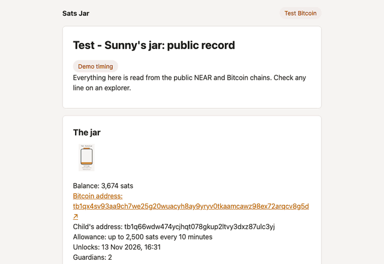
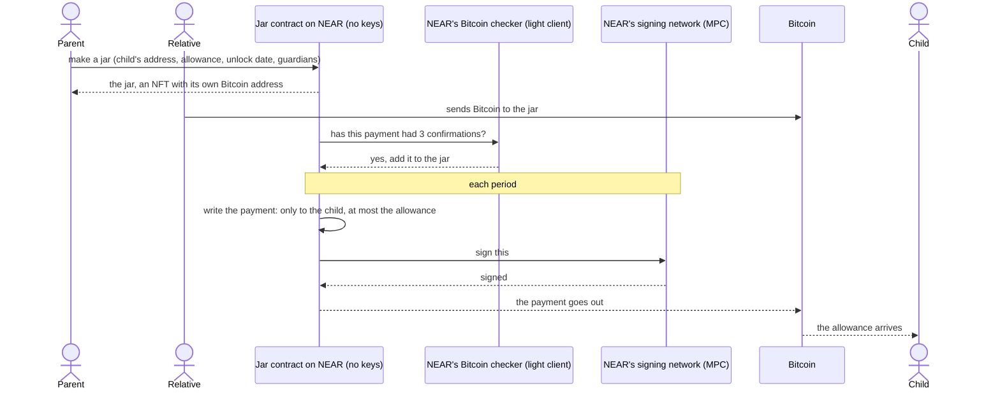
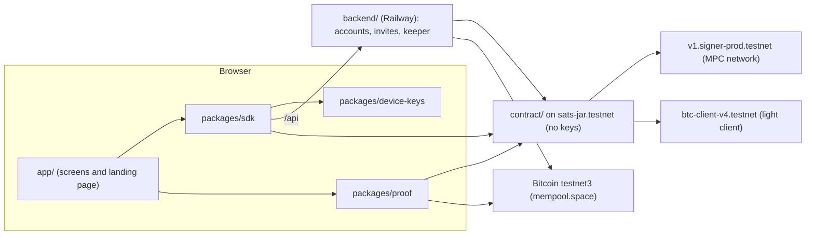

<p align="center">
  <picture>
    <source media="(prefers-color-scheme: dark)" srcset="docs/readme/sats-jar-logo-dark.svg">
    
  </picture>
</p>

<h3 align="center">Set your loved one up for life.</h3>

<p align="center">
A jar is an NFT on NEAR that holds a child's real Bitcoin. Anyone tops it up from a Bitcoin wallet. A NEAR contract with no keys builds each payment itself and asks NEAR's MPC network to sign it only when the jar's rule allows: a capped allowance to the child's address each period, and, at handover, every coin to an address only the child's recovery phrase can recover.
</p>

<p align="center">
  <a href="https://testnet.nearblocks.io/txns/5oZWjXhYuGGVmq4HRcVrnrLTVpGCwDfZMS2XojSWWvCV"></a>
  <a href="https://mempool.space/testnet/tx/c9d3f1faaf1fa6c372339808f6263105e9642bbad59975d751f1094854490b5e"></a>
  <a href="https://testnet.nearblocks.io/txns/A7n7bLAHwctfwy3HrZo9tNiVS2U48ZY9RR2nxg8ViaLo"></a>
</p>

<p align="center">
  <!-- PENDING: demo video URL --><a href="#">Demo video</a> ·
  <a href="https://satsjar.app">Live site</a> ·
  <!-- PENDING: app.satsjar.app goes live with T32 (#48) --><a href="https://app.satsjar.app/new">Make a jar</a> ·
  <a href="#testnet-proof">Testnet proof</a> ·
  <a href="#check-every-claim-yourself">Check every claim yourself</a> ·
  <a href="#hackathon-tracks">Tracks: nfts, open</a>
</p>

<p align="center">
  
</p>

## Who it's for

- A parent or grandparent who holds Bitcoin and wants to give a child real Bitcoin that ends up the child's alone.
- Relatives and friends, who add to the jar from any Bitcoin wallet or exchange app.
- Two or three trusted adults, the guardians, who can approve an emergency payment and confirm the handover.
- The child, who gets a small allowance each period and, from the unlock date, the whole jar on their own phone.

## The problem

A child is too young to hold their own Bitcoin, so today someone holds it for them: an app company, a relative, or a seed phrase in a drawer. Whoever holds it can spend it, lose it, or never hand it over.

What a family actually wants is a jar with rules: a little pocket money now, nothing else except a real emergency, and once the child is grown, the whole jar is theirs alone, with no adult able to touch it. Bitcoin on its own can't enforce rules like that, so until now someone always had to be trusted to follow them.

## Why NEAR

| Promise | What on NEAR keeps it | Testnet evidence |
|---|---|---|
| Nobody can change the rule or move coins outside it, the team included | The jar contract `sats-jar.testnet` has no access keys, and its code hash matches a reproducible build of this repo | [Every key deleted](https://testnet.nearblocks.io/txns/5oZWjXhYuGGVmq4HRcVrnrLTVpGCwDfZMS2XojSWWvCV) |
| A jar pays only what its rule allows | Chain Signatures: the contract builds each Bitcoin payment and its signature hash itself, then asks NEAR's MPC network to sign. No person holds the jar's Bitcoin key | [Allowance request](https://testnet.nearblocks.io/txns/4UGpg2zPVA2gkU3a6WVwnNF16jnoxZXG3i3yDELDWzwm) → [Bitcoin payment](https://mempool.space/testnet/tx/c9d3f1faaf1fa6c372339808f6263105e9642bbad59975d751f1094854490b5e) |
| Only real, confirmed Bitcoin counts | NEAR's Bitcoin light client confirms each top-up is 3 blocks deep before the contract counts it | [Top-up proven](https://testnet.nearblocks.io/txns/DLBwY8ghA1fjqdpXWVd2MHLYMUzGTN6w6Kz2zpq5mZKx) |
| The jar is an NFT that owns its Bitcoin | A NEP-171 token whose picture is drawn on chain from the jar's balance. When it changes hands, its Bitcoin first moves to an address whose Bitcoin-only exit is the new holder's key, then the token moves | [Jar 1 minted](https://testnet.nearblocks.io/txns/AVAy6oMPrAn5B8JMDUtNuNSbbJCRd5TBN44XtKaY9pFc), [Bitcoin moved](https://mempool.space/testnet/tx/5f90716bd2a9a8acf5df517d7ac0b13a9a72b0cb6a085f8286db13a280332393) → [token moved](https://testnet.nearblocks.io/txns/34cWrygt1VWSJn66pJsc69uijpwwU21tgeLcNzLg6e2i) |
| Nobody sees a wallet, gas or an account name | Each person gets a sub-account of the app's account whose only key is made on their own device, and the app's sponsor puts 0.25 testnet NEAR in each new account to cover its NEAR fees | [`evidence/backend-accounts.json`](evidence/backend-accounts.json) |

## How it works



1. **Make a jar.** The parent picks the child's Bitcoin address, how much the allowance is each period, the unlock date, and 2 or 3 trusted adults as guardians. The jar is an NFT on NEAR with its own Bitcoin address. Until handover it sits in a family account the parent controls.
2. **Anyone can top it up.** Grandparents, friends, anyone can send Bitcoin to the jar's address from any wallet or exchange app. Once the payment has 3 confirmations on Bitcoin, NEAR checks it really happened and it counts.
3. **A little at a time, then all of it.** Each period the child gets their allowance, never more than the amount the parent set. A missed period carries over, up to three periods' worth. The Bitcoin fee comes out of the jar, at most a tenth of the allowance per period.

**In an emergency**, two guardians can send the child up to three periods' allowance at once. The payment waits through a public delay, so the parent can cancel it.

**At handover**, from the unlock date on, the child claims the jar, two guardians confirm, and a public delay passes. Then every coin moves to an address only the child can reach, with their phone or their recovery phrase, and the NFT moves to the child. No adult can touch the jar after that.

## Testnet proof

Everything below happened to one jar, jar 1, on the locked contract on 13 Nov 2026, listed in the order each step started. It was made through the hosted app with demo timing, which shortens every wait (a period is 10 minutes, not a month) so the jar's whole life fits in an evening. Each link opens the transaction on a public explorer, and each test link opens the contract test that proves the same step, at the commit the contract was built from.

**The contract**: [`sats-jar.testnet`](https://testnet.nearblocks.io/address/sats-jar.testnet), built from commit [`ecf8379`](https://github.com/koukikouks/sats-jar/tree/ecf837925736db4f684f53846d12a59a57b0df01), code hash `5xerZBZMSJ4kdJiaXkfn15aT7yBVptk4EpWnjr37i1jn`. It signs Bitcoin through `v1.signer-prod.testnet` (NEAR's MPC network) and checks Bitcoin through `btc-client-v4.testnet` (NEAR's Bitcoin light client).

**Jar 1's rule**: an allowance of up to 2,500 sats every 10 minutes, counted from the first proven top-up, an emergency payment of up to 7,500 sats, unlock on 13 Nov 2026 at 21:31 UTC, and 2 guardians. Its first Bitcoin address was [`tb1qx4sv…cv8g5d`](https://mempool.space/testnet/address/tb1qx4sv93aa9ch7we25g20wuacyh8ay9yryv0tkaamcawz98ex72arqcv8g5d). The child's address, [`tb1q66wd…lc3yj`](https://mempool.space/testnet/address/tb1q66wdw474ycjhqt078gkup2ltvy3dxz87ulc3yj), is a test wallet, and it also sent the top-up.

**Who's who**, all accounts the app made:

| Role | NEAR account |
|---|---|
| Parent: the family account, and guardian 1 | [`6d51e1ac2c675964a125.sats-jar-app.testnet`](https://testnet.nearblocks.io/address/6d51e1ac2c675964a125.sats-jar-app.testnet) |
| Guardian 2 | [`0ddc7ba3e015e60238a7.sats-jar-app.testnet`](https://testnet.nearblocks.io/address/0ddc7ba3e015e60238a7.sats-jar-app.testnet) |
| Child | [`1ac525d727cfd5a4b6e0.sats-jar-app.testnet`](https://testnet.nearblocks.io/address/1ac525d727cfd5a4b6e0.sats-jar-app.testnet) |
| Outsider | [`2fe04a619d71531c7248.sats-jar-app.testnet`](https://testnet.nearblocks.io/address/2fe04a619d71531c7248.sats-jar-app.testnet) |
| New holder, after the child transfers the jar | [`69093ade7e19df8671b7.sats-jar-app.testnet`](https://testnet.nearblocks.io/address/69093ade7e19df8671b7.sats-jar-app.testnet) |
| The app's keeper, which proves top-ups and sends due payments | [`keeper-locked.sats-jar-app.testnet`](https://testnet.nearblocks.io/address/keeper-locked.sats-jar-app.testnet) |

| # | What happened | NEAR | Bitcoin | Proved by test |
|---|---|---|---|---|
| 1 | The parent makes the jar. The NFT goes to the family account | [create_jar](https://testnet.nearblocks.io/txns/AVAy6oMPrAn5B8JMDUtNuNSbbJCRd5TBN44XtKaY9pFc) |  | [A new jar is a standard nft held by the family account](https://github.com/koukikouks/sats-jar/blob/ecf837925736db4f684f53846d12a59a57b0df01/contract/tests/nft.rs#L90) |
| 2 | Guardian 2 proposes a 9,000-sat emergency payment: refused, `OVER_EMERGENCY_CAP` | [refused](https://testnet.nearblocks.io/txns/6YtzBnk6kLy92DLay6e32JmMS2i5rKhx2Fsj9c2QaQw5) |  | [An emergency payment is capped at three periods' allowance](https://github.com/koukikouks/sats-jar/blob/ecf837925736db4f684f53846d12a59a57b0df01/contract/tests/emergency.rs#L75) |
| 3 | Guardian 2 proposes 3,000 sats and the parent approves as guardian 1, then cancels it during its public delay | [propose](https://testnet.nearblocks.io/txns/CqiD2ux4Emih2NF23DdyVtE8ZgZXmhLxf5psjJeKNfiv), [approve](https://testnet.nearblocks.io/txns/8E1mYYFhhduSiUo7ma7THspJSDzzHSw5nTKR8r5DE4td), [cancel](https://testnet.nearblocks.io/txns/FYSXzMCKLgZAM3LvypL9vP9HiAwCtFUhsq9nuNdLuyMx) |  | [The giver cancels a proposal before and during its delay](https://github.com/koukikouks/sats-jar/blob/ecf837925736db4f684f53846d12a59a57b0df01/contract/tests/emergency.rs#L176) |
| 4 | The parent proposes 3,000 sats again and guardian 2 approves, which starts a 30-minute public delay | [propose](https://testnet.nearblocks.io/txns/726dU4zrA2KbJGGojcbyBeaurYHQDx8Li1twmo46drjA), [approve](https://testnet.nearblocks.io/txns/DuLBXP8SZPDuLyYTabxnaAgRNW4rij6h59EbTL2WLHKg) |  | [A second guardian's approval starts the public delay](https://github.com/koukikouks/sats-jar/blob/ecf837925736db4f684f53846d12a59a57b0df01/contract/tests/emergency.rs#L129) |
| 5 | The outsider asks the jar to pay 1,000 sats to another address: refused, `SPEND_BEFORE_HANDOVER` | [refused](https://testnet.nearblocks.io/txns/A7n7bLAHwctfwy3HrZo9tNiVS2U48ZY9RR2nxg8ViaLo) |  | [A spend before handover is refused for everyone until the jar has moved](https://github.com/koukikouks/sats-jar/blob/ecf837925736db4f684f53846d12a59a57b0df01/contract/tests/request_spend.rs#L15) |
| 6 | The outsider sends an emergency approval: refused, `NOT_A_GUARDIAN` | [refused](https://testnet.nearblocks.io/txns/5CpKeB8UB7SBbw71C13RuE33PCTyUcUf8ktH7mE77Bfs) |  | [A second guardian's approval starts the public delay](https://github.com/koukikouks/sats-jar/blob/ecf837925736db4f684f53846d12a59a57b0df01/contract/tests/emergency.rs#L129) |
| 7 | The child claims the jar from their phone. No guardian confirms in time, so the claim lapses | [claim](https://testnet.nearblocks.io/txns/7B5QyVRj6o6KfMDPt7UcbJjZ6TYAWqeBLnB9cTmhCSe6) |  | [The child's account claims the jar with its bitcoin key](https://github.com/koukikouks/sats-jar/blob/ecf837925736db4f684f53846d12a59a57b0df01/contract/tests/handover.rs#L12) |
| 8 | A 12,000-sat top-up lands in the jar. The keeper proves it through the light client and it counts | [prove_topup](https://testnet.nearblocks.io/txns/DLBwY8ghA1fjqdpXWVd2MHLYMUzGTN6w6Kz2zpq5mZKx) | [top-up](https://mempool.space/testnet/tx/f8612183f39e0b4c9ecb7069aa4edeb4fbdb61fb2bbce8eb809b83201f1c8449) | [A confirmed top up proven by anyone is counted as a coin](https://github.com/koukikouks/sats-jar/blob/ecf837925736db4f684f53846d12a59a57b0df01/contract/tests/prove_topup.rs#L24) |
| 9 | After the delay, the emergency payment sends the child 3,000 sats | [execute](https://testnet.nearblocks.io/txns/DJ9pQc1X5G6MLNut2P4z1pJpbePswTXLBH1pBNFsfrCZ), [confirm](https://testnet.nearblocks.io/txns/HBb5CQqXx5rCwcWkkViGEKCxxeStobehF2CLkZzZLiT9) | [payment](https://mempool.space/testnet/tx/0ac6f2b82e5b987980b77d4eaf82c2c11aa09029ba1652c373e4a2609f3e2cf1) | [Anyone executes an approved emergency after its delay paying the child exactly](https://github.com/koukikouks/sats-jar/blob/ecf837925736db4f684f53846d12a59a57b0df01/contract/tests/emergency.rs#L358) |
| 10 | One period went unpaid, so the allowance sends the child two periods' worth: 5,000 sats | [request](https://testnet.nearblocks.io/txns/4UGpg2zPVA2gkU3a6WVwnNF16jnoxZXG3i3yDELDWzwm), [confirm](https://testnet.nearblocks.io/txns/6DaTbf4p56RbiWsMcmdcvgjuACaY2Sd1aCqmWSj2EnmK) | [payment](https://mempool.space/testnet/tx/c9d3f1faaf1fa6c372339808f6263105e9642bbad59975d751f1094854490b5e) | [Two unpaid periods carry over into one allowance of three caps](https://github.com/koukikouks/sats-jar/blob/ecf837925736db4f684f53846d12a59a57b0df01/contract/tests/carry_over.rs#L13) |
| 11 | The child claims again and both guardians confirm, which starts the handover's public delay | [claim](https://testnet.nearblocks.io/txns/HF9X8jazxJEQ8y9aRW2okQJDYMdwyEQCruPVPWk46vPW), [confirm](https://testnet.nearblocks.io/txns/GLZDfNunG15Def2CwT7nN14vrffT6DyspEEw99BcvesV), [confirm](https://testnet.nearblocks.io/txns/HHafHhnnCVZt89VAqT3Lkc2a7PVJMNhPTb7PY5ncufAj) |  | [A claim no guardian confirms lapses and a fresh claim follows](https://github.com/koukikouks/sats-jar/blob/ecf837925736db4f684f53846d12a59a57b0df01/contract/tests/handover.rs#L300) |
| 12 | After the unlock date, the handover completes. Every coin moves to a new jar address whose Bitcoin-only exit is the child's key, and once that lands, the NFT moves to the child | [complete_handover](https://testnet.nearblocks.io/txns/FtpMAGFG7fyjw4SrmpabEtCWDEKR191gL7TWYGr3BXFA), [confirm](https://testnet.nearblocks.io/txns/DPZpr7HCzvaKUkpUmS4j6i77vFmLgLqVzJPKyaPEwVXY) | [move](https://mempool.space/testnet/tx/c34af883d7a3ba5c83e6631ed4013a09319d93401ca9d0d62867a9a5a82d5484) | [After the delay and unlock anyone rehomes the coins and the jar moves to the child](https://github.com/koukikouks/sats-jar/blob/ecf837925736db4f684f53846d12a59a57b0df01/contract/tests/handover_complete.rs#L15) |
| 13 | The child, now the holder, sends 1,000 sats to their own address | [request_spend](https://testnet.nearblocks.io/txns/GX8L8q3xkUuRzuWkZWdafrNH2NxUTbSCtY4cBg8j7tV9), [confirm](https://testnet.nearblocks.io/txns/4Kg9BcJ6TfLqJ52rbS4YFfySNucqsTv9cjfDUevNKQML) | [payment](https://mempool.space/testnet/tx/63f76f9702df1c0da3800eeb66edac3343ffc34ecddc8944879b611d424141d0) | [After handover the holder spends a rehomed coin to any address](https://github.com/koukikouks/sats-jar/blob/ecf837925736db4f684f53846d12a59a57b0df01/contract/tests/request_spend.rs#L69) |
| 14 | The parent tries to spend from the jar: refused, `NOT_THE_HOLDER` | [refused](https://testnet.nearblocks.io/txns/7GSv2zamtcrXnuQzUM4RyomVVmZFnBTEdu2pb4eQzZq1) |  | [After handover the family account is not the holder and nothing restarts it](https://github.com/koukikouks/sats-jar/blob/ecf837925736db4f684f53846d12a59a57b0df01/contract/tests/handover_complete.rs#L454) |
| 15 | The child tries to transfer the jar while their payment is unconfirmed: refused, `PAYMENT_PENDING` | [refused](https://testnet.nearblocks.io/txns/JBLQ7B1X76D8j9WozGZAFy64xxogR3Mv1ugkJidu8DYK) |  | [A transfer starts only after handover from the holder and waits for pending payments](https://github.com/koukikouks/sats-jar/blob/ecf837925736db4f684f53846d12a59a57b0df01/contract/tests/transfer.rs#L207) |
| 16 | The child transfers the jar and the new holder accepts with their own key. The coins move to an address whose exit is that key, then the NFT moves | [start](https://testnet.nearblocks.io/txns/7drcYDLD7DrJMqo71BQJfkLqb1p4exkxxf1DNUMU9egN), [accept](https://testnet.nearblocks.io/txns/A8ov7q7GALqzWyjM2akZPtbyLQ5SysrepGDLUZq1thta), [confirm](https://testnet.nearblocks.io/txns/34cWrygt1VWSJn66pJsc69uijpwwU21tgeLcNzLg6e2i) | [move](https://mempool.space/testnet/tx/5f90716bd2a9a8acf5df517d7ac0b13a9a72b0cb6a085f8286db13a280332393) | [The holder transfers the jar and its bitcoin rehomes to the receiver's key](https://github.com/koukikouks/sats-jar/blob/ecf837925736db4f684f53846d12a59a57b0df01/contract/tests/transfer.rs#L36) |

- Every NEAR transaction that sends Bitcoin includes the contract's call to `v1.signer-prod.testnet` and logs the signed Bitcoin transaction.
- Every `prove_topup` and `confirm` calls `btc-client-v4.testnet` to check the Bitcoin transaction is in a block. A confirm marks a payment as landed.
- Each payment's Bitcoin fee came out of the jar: 163 sats on each payment to the child, 132 on each move.
- Testnet3 miners set block times loosely, up to two hours ahead, so a Bitcoin block can show a later time on the explorer than the NEAR transaction that proved it.

## Check every claim yourself

You need Node 22 or later and no keys or coins. This reads the chain through public RPC:

```bash
node --input-type=module <<'JS'
const rpc = async (method, params) => (await (await fetch("https://rpc.testnet.near.org", { method: "POST", headers: { "content-type": "application/json" }, body: JSON.stringify({ jsonrpc: "2.0", id: 1, method, params }) })).json()).result;
const account = (request_type) => rpc("query", { request_type, finality: "final", account_id: "sats-jar.testnet" });
const view = async (account_id, method_name, args) => JSON.parse(Buffer.from((await rpc("query", { request_type: "call_function", finality: "final", account_id, method_name, args_base64: Buffer.from(JSON.stringify(args)).toString("base64") })).result).toString());
console.log("1. access keys on sats-jar.testnet:", (await account("view_access_key_list")).keys.length);
console.log("2. code hash:", (await account("view_account")).code_hash);
const jar = await view("sats-jar.testnet", "get_jar", { jar_id: "1" });
const mpc = await view("v1.signer-prod.testnet", "derived_public_key", { path: "1", predecessor: "sats-jar.testnet", domain_id: 0 });
console.log("3. jar 1's Bitcoin key is the MPC network's key for it:", jar.public_key === mpc);
const tx = await rpc("EXPERIMENTAL_tx_status", { tx_hash: "A7n7bLAHwctfwy3HrZo9tNiVS2U48ZY9RR2nxg8ViaLo", sender_account_id: "2fe04a619d71531c7248.sats-jar-app.testnet", wait_until: "FINAL" });
console.log("4. early spend refused:", JSON.stringify(tx.status.Failure).match(/SPEND_BEFORE_HANDOVER[^"\\]*/)[0]);
JS
```

Expected output:

```
1. access keys on sats-jar.testnet: 0
2. code hash: 5xerZBZMSJ4kdJiaXkfn15aT7yBVptk4EpWnjr37i1jn
3. jar 1's Bitcoin key is the MPC network's key for it: true
4. early spend refused: SPEND_BEFORE_HANDOVER: before handover only the allowance and an emergency payment can pay out, and only to the child's address
```

Line 1 means nobody can redeploy the contract or sign as it. Line 3 means no person holds the jar's Bitcoin key: it is the MPC network's key for this contract and this jar.

To check that the deployed code is this repo's code, rebuild it with Docker and cargo-near 0.22.0. The build takes a few minutes, and the checksum it prints must equal line 2:

```bash
git clone https://github.com/koukikouks/sats-jar && cd sats-jar && git checkout ecf837925736db4f684f53846d12a59a57b0df01
cargo near build reproducible-wasm --manifest-path contract/Cargo.toml
```

Every row in [Testnet proof](#testnet-proof) opens on NearBlocks or mempool.space. The test named in each row is in [`contract/tests/`](contract/tests), and [Run the tests](#run-the-tests) runs them.

## Known gaps

- Testnet only. The coins are test coins and the contract has never run on mainnet.
- Fee replacement (RBF) is designed but not built. A payment sent at too low a fee could stay unconfirmed and hold the jar; at testnet3's 1 sat/vB this does not happen, but mainnet needs RBF first.
- The Bitcoin-only exit is proven on regtest in the tests, not used on the locked contract.
- After handover, nobody, Sats Jar included, can recover the child's jar without their phone or their recovery phrase.
- The public record lists Bitcoin transactions at the jar's current address only, so after the Bitcoin moves at handover the list starts at the move.
- Anyone can make accounts on the hosted app (0.25 testnet NEAR each from the sponsor) or run a keeper pass; there is no rate limit.
- Sign-in is a 6-digit PIN; Face ID is not built.

## Use it

The app is at [app.satsjar.app](https://app.satsjar.app/new). <!-- PENDING: live with T32 (#48) --> It costs nothing: the app funds each new account with the NEAR it needs. Topping up needs testnet3 Bitcoin from a faucet in an ordinary testnet wallet.

### Make a jar for a child

1. Open [app.satsjar.app/new](https://app.satsjar.app/new). Type a 6-digit PIN twice and press **Set up**. Nobody can reset it, so keep it. You see "Start a jar". Coming back later, the same PIN unlocks the app at "Unlock Sats Jar", and a jar still being set up is listed on the home page.
2. Type a jar nickname, choose 2 or 3 guardians and press **Make invite links**. You see one link per guardian.
3. To be a guardian yourself, press **Use a link myself**. Send each other link to a guardian.
4. The guardian opens their link, types a PIN twice, presses **Set up**, then presses **Join as a guardian**. Each link works once. On your page their link shows "Joined" within 10 seconds. To try this alone, open the link in a second browser or browser profile: each one is a separate device.
5. Once 2 guardians have joined, fill in "The jar's rule". Under "Where should the allowance go?", paste the child's `tb1q…` address from a testnet3 wallet you control. Set "Allowance per period (sats)", choose **Demo timing: every 10 minutes**, and the unlock date becomes "Unlocks in (minutes)". Press **Create the jar**.
6. You see the jar's QR code and address. Send at least 1,000 testnet3 sats to it from your wallet. It counts after 3 confirmations and the keeper's next hourly pass, usually within two hours.
7. Once a top-up counts, the allowance goes to the child's address every period without anyone pressing anything.

### Try to break a jar's rule, without coins

1. Open jar 1's public record at [app.satsjar.app/proof/1](https://app.satsjar.app/proof/1). <!-- PENDING: live with T32 (#48) --> No sign-in is needed to read it.
2. Under "Try to break the rule", set up a PIN on this device when asked.
3. Press a button there, such as **Send its Bitcoin somewhere else before handover** or **Approve its emergency payment as an outsider**. You see "Refused:" with the contract's reason, and **Check it yourself ↗** opens the failed transaction on NearBlocks.

### Hand the jar to the child

From the jar page, a guardian or the giver copies the "Set up my jar" link and sends it to the child. On their own phone the child presses **Show my recovery phrase**, writes down the 12 words, types 3 of them back, chooses a PIN and presses **Claim my jar**. Each guardian presses **Check the child's code**, compares it with the child's phone in person and presses **It matches: confirm**. After a public delay and the unlock date, the keeper moves the jar's Bitcoin and then the jar to the child.

## Architecture



| Folder | What it is | What it does |
|---|---|---|
| [`contract/`](contract) | The jar contract (Rust, near-sdk) | Holds every jar as an NFT, runs the rule, builds each Bitcoin payment and asks the MPC network to sign it |
| [`btc/`](btc) | Bitcoin code used by the contract | Parses and builds segwit transactions, the jar's P2WSH script and BIP-143 signature hashes |
| [`packages/device-keys/`](packages/device-keys) | Keys on the person's device | Makes each person's keys in the browser under their PIN, and the child's 12-word recovery phrase |
| [`packages/sdk/`](packages/sdk) | The App SDK | Every action a person takes, as one call each, with refusals in plain words |
| [`packages/proof/`](packages/proof) | The public record's reader | Reads a jar, its NEAR requests and its Bitcoin transactions from public explorers |
| [`app/`](app) | The web app (Vite, React) | The screens over the SDK, the public record, and the landing page |
| [`backend/`](backend) | The app's server | Makes each person's account, holds guardian invites until the jar exists, and runs the hourly keeper |
| [`scripts/`](scripts) | Testnet scripts | The locked deploy and the earlier testnet runs |
| [`evidence/`](evidence) | Testnet records | Hashes, key lists and code hashes from every testnet run |
| [`docs/adr/`](docs/adr) | Decisions | Why each design choice was made |

## Threat model

### What is verified, and what is trusted

Verified: the contract has no keys and its code is this repo's (lines 1 and 2 of [Check every claim yourself](#check-every-claim-yourself)), the rule's behaviour (the contract tests, joined with Bitcoin Core on regtest), and every payment and refusal in [Testnet proof](#testnet-proof).

Trusted:

- **NEAR's MPC network** signs a jar's Bitcoin payments. Its committee can change and its contract can be upgraded through NEAR's own process. If it stopped for good, the jar's coins could still leave through the Bitcoin-only exit, which opens two years after the unlock date (or after the Bitcoin moved at handover) and pays the child's key on Bitcoin alone.
- **NEAR's Bitcoin light client** (`btc-client-v4.testnet`) tells the contract a top-up is real. It has one full-access key, three pause managers and one relayer, `btc-relayer.testnet`, that submits Bitcoin headers.
- **The app's sponsor** (`sats-jar-app.testnet`) puts 0.25 testnet NEAR in each new account, which covers that person's NEAR fees. It has no role in any jar, and NEAR gives a parent account no power over its sub-accounts.
- **The app's keeper** (`keeper-locked.sats-jar-app.testnet`) proves top-ups, asks for allowances and moves coins at handover. Its only key can call `sats-jar.testnet` without a deposit, so it can do only what anyone may do ([`evidence/hosting.json`](evidence/hosting.json)). It runs as one process on Railway.
- **A parent** controls the child's address until handover.
- **The guardians, at handover.** If two guardians collude, they could confirm an account they control as the child's.
- **The app's code in the browser.** The child's keys are made on their phone by the app's code, so "nobody else can use them" holds only if the served code is this repo's.

### How control passes, and what stops a seller keeping the money

The jar changes hands for the first time at handover, from the family account to the child's account. After that the holder can transfer it like any NFT, through `start_transfer` and `accept_transfer`. Either way, the contract first moves every coin to a new jar address whose Bitcoin-only exit is the new holder's own key, and the NFT moves only once that payment is confirmed on Bitcoin.

| A seller tries to | What stops it | Test |
|---|---|---|
| Keep a signed payment and broadcast it after the sale | A transfer is refused while any payment is pending | `a_transfer_starts_only_after_handover_from_the_holder_and_waits_for_pending_payments` |
| Keep the old Bitcoin-only exit key | Every coin moves to an address whose exit is the new holder's key before the NFT moves | `the_holder_transfers_the_jar_and_its_bitcoin_rehomes_to_the_receivers_key` |
| Choose the key the coins move to | Only the receiver's own account can supply it | `only_the_receivers_own_account_supplies_the_key` |
| Skip the move with a plain NFT transfer | `nft_transfer` is refused and points to `start_transfer` | `a_plain_transfer_is_refused_and_points_to_start_transfer` |
| Keep an approval to take the jar back | Approvals are refused before handover and cleared on every move | `approvals_are_refused_before_handover`, `every_approval_is_cleared_when_the_jar_moves` |
| Spend while a transfer is open | Spends are refused until it is accepted or cancelled | `the_holder_cancels_a_transfer_until_it_is_accepted_and_cannot_spend_while_one_is_open` |
| Reach a top-up sent later to the old address | It still counts and is swept to the new address | `a_top_up_to_an_old_address_after_handover_counts_and_is_swept_to_the_current_address` |
| Act as the family after handover | Every request fails with "not the holder" | `after_handover_the_family_account_is_not_the_holder_and_nothing_restarts_it` |

Before handover, no guardian can direct a payment anywhere but the child's address: a spend is refused for everyone, as the early-spend row of [Testnet proof](#testnet-proof) shows. The two ways adults could still reach the coins, a parent's control of the child's address and guardians colluding at handover, are in the trusted list above.

## Similar projects

Bitcoin set aside for a child isn't new in crypto. Two come closest:

- [Playroom](https://ethglobal.com/showcase/playroom-wykmm) (ETHGlobal Taipei 2025) escrows wrapped Bitcoin (cBTC on Citrea) as allowances, with parents approving withdrawals. A jar holds native Bitcoin, and no adult approves the allowance.
- [Lit Protocol's PKPs](https://spark.litprotocol.com/programming-bitcoin/) let an NFT own a threshold key whose JavaScript rule decides whether to sign a Bitcoin hash the caller built. A jar's contract builds the payment itself, so the rule checks the real payee, amount and fee.

NEAR makes it possible for a keyless contract to hold the rule, check Bitcoin deposits and get native Bitcoin payments signed ([Why NEAR](#why-near)).

## Roadmap

### Phase 1: mainnet

- Fee replacement: a stuck payment can be replaced at a higher fee within its fee bound. Measure: a payment sent at too low a rate confirms after replacement, on testnet.
- A mainnet deploy against NEAR's mainnet MPC network (`v1.signer`) and the light client NEAR's own Bitcoin bridge uses (`btc-client.bridge.near`), locked with no keys like the testnet one. Measure: a mainnet allowance paid from a proven top-up.
- Face ID unlock alongside the PIN. Measure: a person signs in on a phone without typing the PIN.

### Phase 2: reach

- Top up with any coin, through NEAR Intents, so a relative without Bitcoin can still add to a jar. Measure: a top-up paid in another coin arrives in a jar as Bitcoin.
- A public record that follows the jar's Bitcoin across every address it has had. Measure: a handed-over jar shows its whole Bitcoin history.

### Sustainability

Today the app's sponsor funds each person's account with the NEAR its fees need, and Bitcoin fees come from each jar. On mainnet, a small fee on each top-up, paid in Bitcoin, would cover the sponsor's NEAR.

### How NEAR could help

- Bitcoin in the MPC network's foreign-chain verification, so a contract could check a Bitcoin deposit without a separate light client and its operators.
- A published commitment on how long the MPC network will keep signing for contracts, since a jar lasts until a child is grown.

## Hackathon tracks

- **nfts**: the jar is an NFT that owns native Bitcoin, carries its rule and moves its coins to the new holder's key when it changes hands ([Why NEAR](#why-near), the NFT row; [Threat model](#threat-model)).
- **open**: a spending rule on native Bitcoin, enforced by a keyless NEAR contract through Chain Signatures ([Why NEAR](#why-near), the second row).

## Run the tests

`cargo test` runs the Rust suites and `pnpm test` runs the TypeScript ones. Each test names the behaviour it proves.

| Suite | Command | Proves |
|---|---|---|
| Jar contract | `cargo test -p sats-jar` | Every rule and refusal, called as the app calls it in a NEAR sandbox; each payment the contract signs is accepted by Bitcoin Core on regtest |
| Bitcoin code | `cargo test -p btc` | Signature hashes against the official BIP-143 vectors, and the jar's address and script |
| Device keys | `pnpm test packages/device-keys` | Recovery phrase to NEAR and Bitcoin keys, against published BIP-39, BIP-84 and NEAR wallet vectors |
| SDK, public record, backend, app screens | `pnpm test` | Each action calls the contract as the rule expects, refusals read in plain words, and each screen shows the right state |

The Rust tests download a NEAR sandbox and Bitcoin Core the first time. Install with `pnpm install` first.

## Built with, and disclosures

| Used for | Libraries |
|---|---|
| The contract | near-sdk, k256 |
| Contract tests | near-workspaces, cargo-near-build, the bitcoin crate, bitcoind (Bitcoin Core on regtest), tokio |
| Keys and Bitcoin in TypeScript | near-api-js, @scure/bip39, @scure/bip32, @scure/btc-signer, @scure/base, @noble/curves, @noble/hashes |
| The web app | React, React Router, TanStack Query, Vite, qrcode |
| Tests | Vitest, Testing Library, jsdom, Playwright |

- AI coding agents (Claude Code) wrote much of the code and documentation, under my review.
- My other entry in this hackathon is BounTEE, an independent project. <!-- PENDING: BounTEE repo URL -->
- An earlier feasibility test of an NFT-gated contract getting a Bitcoin payment signed (1 Nov 2026) was throwaway; none of its code is reused.

<p align="center">
  <br>
  Built at the NEAR Hackathon, 2026. <!-- PENDING: LICENSE file and its name here -->
</p>
